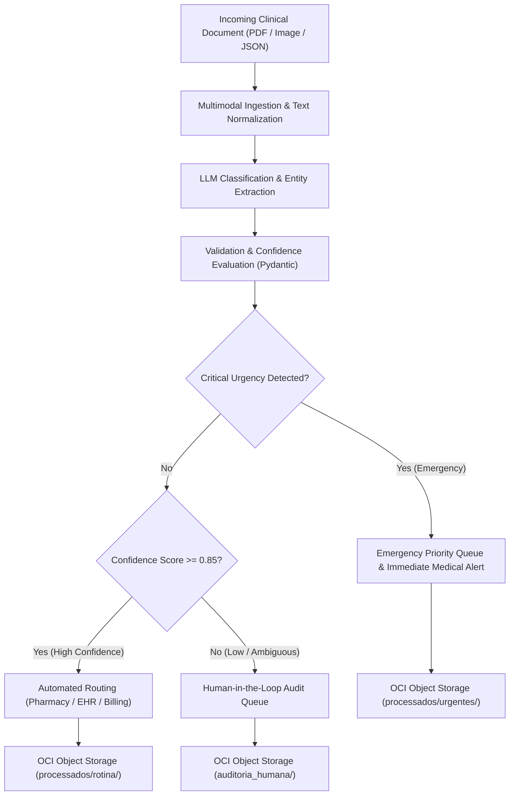
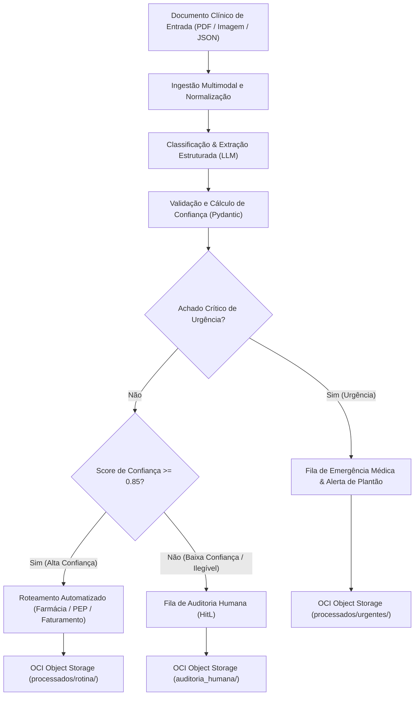
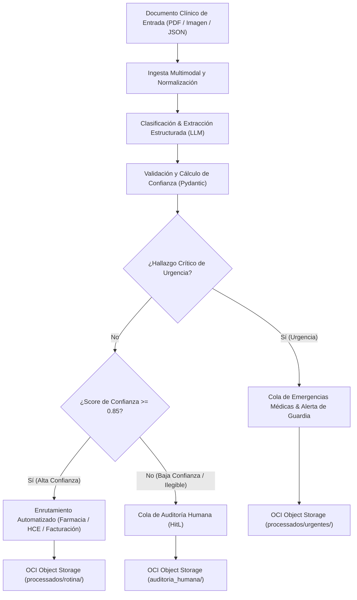

# 🏥 MediFlow — Autonomous Clinical Document Triage, Extraction & Routing Agent

[](LICENSE)
[](https://www.python.org/)
[](https://www.oracle.com/cloud/free/)
[](https://langchain-ai.github.io/langgraph/)
[](https://www.oracle.com/br/education/oracle-next-education/)

---

### 🌐 Language / Idioma
- [🇺🇸 English Version (EN-US)](#-english-version-en-us)
- [🇧🇷 Versão em Português (PT-BR)](#-versão-em-português-pt-br)
- [🇪🇸 Versión en Español (ES)](#-versión-en-español-es)

---

## 🇺🇸 English Version (EN-US)

### 1. Overview & Business Problem
Hospitals, clinical laboratories, and health insurance providers process thousands of heterogeneous documents every day, including:
- Medical Prescriptions (*Receituários*)
- Imaging & Laboratory Diagnostic Reports (*Laudos*)
- Authorization Guides (*Guias TISS/TUSS*)
- Surgical & Inpatient Discharge Summaries
- Sick Leave Certificates (*Atestados*)

Manual processing causes severe operational bottlenecks, transcription errors, glosas (insurance payment denials), and life-threatening delays in treating urgent conditions (e.g., Acute Pulmonary Embolism, Stroke, Sepsis).

**MediFlow** is an autonomous AI agent engineered to ingest, classify, extract structured clinical data, evaluate confidence scores, and conditionally route clinical documents to target hospital queues or Human-in-the-Loop auditors, persisting all assets in **Oracle Cloud Infrastructure (OCI) Object Storage (Always Free tier)**.

---

### 2. Core Specification v0.1

#### 2.1 Scope & System Capabilities
1. **Multimodal Ingestion Engine**: Ingests clinical documents in text, digital/scanned PDF, and high-resolution clinical images.
2. **Clinical Entity Classifier & Extractor**: Utilizes Multimodal LLMs (Google Gemini / OpenAI / Claude) to extract:
   - Patient demographics (name, age)
   - Requesting physician information (name, CRM, state)
   - Performed procedures or exams
   - Suspected/confirmed diagnoses and ICD-10 (CID-10) codes
   - Prescriptions, medications, dosages, and administration routes
3. **Clinical Priority & Urgency Scoring**: Identifies life-critical findings and computes an extraction confidence score ($0.0 \le \text{score} \le 1.0$).
4. **Conditional Decision Graph (LangGraph)**:
   - **Routine Approved**: High confidence ($\ge 0.85$), standard priority $\rightarrow$ Hospital Pharmacy / EHR Archive / Audit.
   - **Emergency Alert**: Critical diagnosis or urgent status $\rightarrow$ On-Call Medical Emergency Queue with real-time alert dispatch.
   - **Human-in-the-Loop (HitL)**: Low confidence ($< 0.85$) or unreadable/ambiguous data $\rightarrow$ Human Clinical Auditor Queue.
5. **OCI Cloud Segregation**: Segregated storage in OCI Object Storage Always Free buckets:
   - `/recebidos` (raw incoming documents)
   - `/processados/rotina` (standard processed JSON records)
   - `/processados/urgentes` (emergency prioritized records)
   - `/auditoria_humana` (records flagged for auditor intervention)

---

#### 2.2 System Architecture & Decision Flow



---

#### 2.3 Data Contracts (JSON Schemas)

##### Input Payload (Request)
```json
{
  "documento_id": "DOC-CLIN-2026-8942",
  "tipo_arquivo": "PDF",
  "documento_texto": "HOSPITAL SANTA LUCIA - LAUDO DE EXAME RADIOLOGICO. Paciente: Carlos Eduardo Mendes, 52 anos. Solicitante: Dra. Renata Silveira CRM-SP 145892. Exame: Tomografia de Torax com contraste. Indicacao: Suspeita de embolia pulmonar aguda, dispneia subita. Achados: Falha de enchimento em arteria pulmonar principal direita compativel com TEP agudo. CONCLUSÃO: Quadro compativel com Tromboembolismo Pulmonar Agudo. Sugere-se correlacao clinica urgente.",
  "canal_origem": "Pronto_Socorro"
}
```

##### Output Payload (Structured Triage Response)
```json
{
  "status": "processado",
  "documento_id": "DOC-CLIN-2026-8942",
  "classificacao": {
    "tipo_documento": "Laudo de Exame de Imagem",
    "especialidade": "Radiologia / Pneumologia",
    "nivel_prioridade": "Urgente",
    "score_confianca_classificacao": 0.99
  },
  "dados_extraidos": {
    "paciente": {
      "nome": "Carlos Eduardo Mendes",
      "idade": 52
    },
    "medico_solicitante": {
      "nome": "Dra. Renata Silveira",
      "crm": "145892-SP"
    },
    "exame_realizado": "Tomografia de Torax com contraste",
    "diagnostico_principal": "Tromboembolismo Pulmonar Agudo (TEP)",
    "cid_sugerido": "I26.9"
  },
  "decisao_roteamento": {
    "destino_principal": "Fila_Emergencia_Medica",
    "requer_auditoria_humana": false,
    "justificativa_roteamento": "Achado critico de alta gravidade (TEP agudo) detectado em paciente sintomatico.",
    "notificacao_gerada": {
      "canal": "Alerta_Plantao_Medico",
      "mensagem": "ALERTA URGENTE: Laudo critico de TEP Agudo para paciente Carlos Eduardo Mendes no Pronto-Socorro."
    }
  },
  "armazenamento_oci": {
    "bucket": "mediflow-documentos-clinicos",
    "caminho_objeto": "processados/urgentes/DOC-CLIN-2026-8942.json",
    "status_backup": "sucesso"
  }
}
```

---

#### 2.4 Mandatory Evaluation Scenarios
- **Scenario 1 (Routine Flow Approved)**: Standard outpatient prescription with high confidence $\rightarrow$ routed to Pharmacy and archived without human intervention.
- **Scenario 2 (Medical Urgency Priority)**: Critical diagnostic report (e.g., Acute Pulmonary Embolism / TEP) $\rightarrow$ flagged with Urgente priority, instant alert triggered to on-call medical staff.
- **Scenario 3 (Ambiguous / Low Confidence)**: Illegible handwriting or missing essential clinical fields $\rightarrow$ routed to Human-in-the-Loop review queue.

---

### 3. Repository Structure
```
ONE/
├── .gitignore                         # Configured to protect secrets and internal memory
├── LICENSE                            # MIT License
├── README.md                          # Trilingual Documentation & Core Spec v0.1
├── memory.md                          # Persistent Project Memory & Milestone Tracker (ignored in git)
└── G10-BRASIL-equipo-22-Medflow/
    └── Docs/
        ├── Projeto_2_Medflow_Spec.pdf # Original Hackathon Project Specification
        └── medflow.md                 # Markdown transcript of the challenge guidelines
```

---

<br/>

## 🇧🇷 Versão em Português (PT-BR)

### 1. Visão Geral e Contexto Clínico
Hospitais, clínicas, laboratórios e operadoras de saúde lidam diariamente com volumes massivos de documentos heterogêneos:
- Receituários Médicos
- Laudos de Exames Laboratoriais e de Imagem
- Guias de Solicitação de Procedimentos (Padrão TISS/TUSS)
- Relatórios Cirúrgicos e de Alta/Internação
- Atestados Médicos

A triagem manual destes documentos gera lentidão, alto índice de glosas hospitalares, erros de digitação e atrasos fatais no atendimento a quadros graves (como Tromboembolismo Pulmonar, Infarto Agudo do Miocárdio e Sepse).

O **MediFlow** é um agente autônomo e inteligente para ingestão, classificação automatizada, extração estruturada de entidades clínicas, avaliação de score de confiança e roteamento condicional com suporte a **Human-in-the-Loop**, com persistência no **Oracle Cloud Infrastructure (OCI) Object Storage (Camada Always Free)**.

---

### 2. Especificação Central (Core Spec v0.1)

#### 2.1 Escopo e Capacidades do Sistema
1. **Pipeline de Ingestão Multimodal**: Recebe arquivos em PDF (digital ou escaneado), imagens clínicas e texto estruturado/JSON.
2. **Classificação e Extração com LLMs Multimodais**: Utiliza LLMs (Google Gemini, OpenAI, Claude) para identificar:
   - Dados do paciente (nome, idade)
   - Médico solicitante (nome, CRM, UF)
   - Exames realizados ou solicitados
   - Hipótese diagnóstica e código CID-10
   - Prescrição de medicamentos, dosagens e vias de administração
3. **Score de Confiabilidade e Detecção de Urgências**: Calcula métrica de confiança ($0.0 \le \text{score} \le 1.0$) e detecta achados críticos de urgência.
4. **Grafo de Decisão Condicional (LangGraph)**:
   - **Fluxo de Rotina Aprovado**: Score de confiança alto ($\ge 0.85$), prioridade habitual $\rightarrow$ Farmácia / Prontuário / Auditoria.
   - **Urgência Médica**: Diagnóstico crítico identificado $\rightarrow$ Fila de Emergência Médica com disparo de notificação imediata.
   - **Auditoria Humana (Human-in-the-Loop)**: Score baixo ($< 0.85$) ou campos vitais ausentes/ilegíveis $\rightarrow$ Fila de Revisão Humana.
5. **Segregação de Armazenamento no OCI Object Storage**:
   - `/recebidos` (documentos brutos ingeridos)
   - `/processados/rotina` (registros JSON aprovados automaticamente)
   - `/processados/urgentes` (casos de urgência com alerta acionado)
   - `/auditoria_humana` (casos direcionados para revisão de auditor)

---

#### 2.2 Arquitetura e Grafo de Decisão



---

#### 2.3 Contratos de Dados (Esquemas JSON)

##### Requisição de Entrada
```json
{
  "documento_id": "DOC-CLIN-2026-8942",
  "tipo_arquivo": "PDF",
  "documento_texto": "HOSPITAL SANTA LUCIA - LAUDO DE EXAME RADIOLOGICO. Paciente: Carlos Eduardo Mendes, 52 anos. Solicitante: Dra. Renata Silveira CRM-SP 145892. Exame: Tomografia de Torax com contraste. Indicacao: Suspeita de embolia pulmonar aguda, dispneia subita. Achados: Falha de enchimento em arteria pulmonar principal direita compativel com TEP agudo. CONCLUSÃO: Quadro compativel com Tromboembolismo Pulmonar Agudo. Sugere-se correlacao clinica urgente.",
  "canal_origem": "Pronto_Socorro"
}
```

##### Resposta Estruturada da Triagem
```json
{
  "status": "processado",
  "documento_id": "DOC-CLIN-2026-8942",
  "classificacao": {
    "tipo_documento": "Laudo de Exame de Imagem",
    "especialidade": "Radiologia / Pneumologia",
    "nivel_prioridade": "Urgente",
    "score_confianca_classificacao": 0.99
  },
  "dados_extraidos": {
    "paciente": {
      "nome": "Carlos Eduardo Mendes",
      "idade": 52
    },
    "medico_solicitante": {
      "nome": "Dra. Renata Silveira",
      "crm": "145892-SP"
    },
    "exame_realizado": "Tomografia de Torax com contraste",
    "diagnostico_principal": "Tromboembolismo Pulmonar Agudo (TEP)",
    "cid_sugerido": "I26.9"
  },
  "decisao_roteamento": {
    "destino_principal": "Fila_Emergencia_Medica",
    "requer_auditoria_humana": false,
    "justificativa_roteamento": "Achado critico de alta gravidade (TEP agudo) detectado em paciente sintomatico.",
    "notificacao_gerada": {
      "canal": "Alerta_Plantao_Medico",
      "mensagem": "ALERTA URGENTE: Laudo critico de TEP Agudo para paciente Carlos Eduardo Mendes no Pronto-Socorro."
    }
  },
  "armazenamento_oci": {
    "bucket": "mediflow-documentos-clinicos",
    "caminho_objeto": "processados/urgentes/DOC-CLIN-2026-8942.json",
    "status_backup": "sucesso"
  }
}
```

---

#### 2.4 Cenários de Teste Obrigatórios (Checklist de Avaliação)
- **Cenário 1 (Fluxo Padrão Aprovado)**: Receituário com dados legíveis e alta confiança $\rightarrow$ encaminhado à Farmácia/PEP sem toque humano.
- **Cenário 2 (Prioridade de Urgência Médica)**: Laudo com achado grave (ex.: TEP / Tromboembolismo) $\rightarrow$ classificação Urgente e notificação para equipe médica.
- **Cenário 3 (Ambiguidade / Baixa Confiança)**: Documento rasurado ou dados inconsistentes $\rightarrow$ encaminhado para tela de revisão humana (*Human-in-the-Loop*).

---

### 3. Estrutura do Repositório
```
ONE/
├── .gitignore                         # Configurado para ignorar variáveis de ambiente e arquivos de memória interna
├── LICENSE                            # Licença MIT
├── README.md                          # Documentação e Core Spec v0.1 trilingue
├── memory.md                          # Memória contínua do projeto e tracking de entregas (ignorado no Git)
└── G10-BRASIL-equipo-22-Medflow/
    └── Docs/
        ├── Projeto_2_Medflow_Spec.pdf # Especificação original do Hackathon ONE
        └── medflow.md                 # Diretrizes e detalhes do desafio MediFlow
```

---

<br/>

## 🇪🇸 Versión en Español (ES)

### 1. Visión General y Contexto Clínico
Hospitales, clínicas, laboratorios y aseguradoras de salud gestionan a diario un volumen masivo de documentos heterogéneos:
- Recetas Médicas (*Prescripciones*)
- Informes y Resultados de Exámenes Diagnósticos e Imagenológicos (*Laudos*)
- Volantes y Guías de Autorización de Procedimientos (Estándar TISS/TUSS)
- Resúmenes de Alta e Informes Quirúrgicos
- Certificados de Incapacidad / Bajas Médicas

El procesamiento manual de estos documentos genera cuellos de botella operativos, altos índices de glosas (rechazos de facturación médica), errores de transcripción y demoras potencialmente fatales en la atención de patologías críticas (como Tromboembolismo Pulmonar Agudo, Infarto Agudo de Miocardio y Sepsis).

**MediFlow** es un agente autónomo e inteligente diseñado para la ingesta, clasificación automatizada, extracción estructurada de entidades clínicas, cálculo de score de confianza y enrutamiento condicional con soporte de **Human-in-the-Loop** (auditoría humana), con persistencia de documentos y decisiones en **Oracle Cloud Infrastructure (OCI) Object Storage (Capa Always Free)**.

---

### 2. Especificación Central (Core Spec v0.1)

#### 2.1 Alcance y Capacidades del Sistema
1. **Motor de Ingesta Multimodal**: Admite documentos clínicos en formato PDF (digital o escaneado), imágenes diagnósticas de alta resolución y texto estructurado/JSON.
2. **Clasificación y Extracción con LLMs Multimodales**: Utiliza LLMs (Google Gemini, OpenAI, Claude) para extraer:
   - Datos demográficos del paciente (nombre, edad)
   - Médico solicitante (nombre, número de colegiado/CRM, estado/región)
   - Exámenes o procedimientos realizados y solicitados
   - Diagnóstico principal e hipótesis clínica con código CIE-10 (CID-10)
   - Medicamentos prescritos, posología, dosificación y vías de administración
3. **Score de Confiabilidad y Detección de Urgencias**: Calcula una métrica de confianza ($0.0 \le \text{score} \le 1.0$) y detecta hallazgos críticos de emergencia clínica.
4. **Grafo de Decisión Condicional (LangGraph)**:
   - **Flujo de Rutina Aprobado**: Confianza alta ($\ge 0.85$), prioridad habitual $\rightarrow$ Farmacia Hospitalaria / Historia Clínica Electrónica (HCE) / Auditoría.
   - **Urgencia Médica**: Hallazgo crítico detectado $\rightarrow$ Cola de Emergencias Médicas y despacho de alerta inmediata al médico de guardia.
   - **Auditoría Humana (Human-in-the-Loop)**: Confianza baja ($< 0.85$) o datos ilegibles/ambiguos $\rightarrow$ Cola de Revisión Humana.
5. **Segregación de Almacenamiento en OCI Object Storage**:
   - `/recebidos` (documentos originales recibidos)
   - `/processados/rotina` (registros JSON aprobados automáticamente)
   - `/processados/urgentes` (registros de urgencia con alerta emitida)
   - `/auditoria_humana` (casos derivados a revisión de auditor)

---

#### 2.2 Arquitectura y Grafo de Decisión



---

#### 2.3 Contratos de Datos (Esquemas JSON)

##### Petición de Entrada (Request)
```json
{
  "documento_id": "DOC-CLIN-2026-8942",
  "tipo_arquivo": "PDF",
  "documento_texto": "HOSPITAL SANTA LUCIA - LAUDO DE EXAME RADIOLOGICO. Paciente: Carlos Eduardo Mendes, 52 anos. Solicitante: Dra. Renata Silveira CRM-SP 145892. Exame: Tomografia de Torax com contraste. Indicacao: Suspeita de embolia pulmonar aguda, dispneia subita. Achados: Falha de enchimento em arteria pulmonar principal direita compativel com TEP agudo. CONCLUSÃO: Quadro compativel com Tromboembolismo Pulmonar Agudo. Sugere-se correlacao clinica urgente.",
  "canal_origem": "Pronto_Socorro"
}
```

##### Respuesta Estructurada del Triaje (Response)
```json
{
  "status": "processado",
  "documento_id": "DOC-CLIN-2026-8942",
  "classificacao": {
    "tipo_documento": "Laudo de Exame de Imagem",
    "especialidade": "Radiologia / Pneumologia",
    "nivel_prioridade": "Urgente",
    "score_confianca_classificacao": 0.99
  },
  "dados_extraidos": {
    "paciente": {
      "nome": "Carlos Eduardo Mendes",
      "idade": 52
    },
    "medico_solicitante": {
      "nome": "Dra. Renata Silveira",
      "crm": "145892-SP"
    },
    "exame_realizado": "Tomografia de Torax com contraste",
    "diagnostico_principal": "Tromboembolismo Pulmonar Agudo (TEP)",
    "cid_sugerido": "I26.9"
  },
  "decisao_roteamento": {
    "destino_principal": "Fila_Emergencia_Medica",
    "requer_auditoria_humana": false,
    "justificativa_roteamento": "Achado critico de alta gravidade (TEP agudo) detectado em paciente sintomatico.",
    "notificacao_gerada": {
      "canal": "Alerta_Plantao_Medico",
      "mensagem": "ALERTA URGENTE: Laudo critico de TEP Agudo para paciente Carlos Eduardo Mendes no Pronto-Socorro."
    }
  },
  "armazenamento_oci": {
    "bucket": "mediflow-documentos-clinicos",
    "caminho_objeto": "processados/urgentes/DOC-CLIN-2026-8942.json",
    "status_backup": "sucesso"
  }
}
```

---

#### 2.4 Escenarios de Evaluación Obligatorios
- **Escenario 1 (Flujo de Rutina Aprobado)**: Receta ambulatoria estándar con datos legibles y alta confianza $\rightarrow$ enrutada a Farmacia/HCE sin intervención humana.
- **Escenario 2 (Prioridad de Urgencia Médica)**: Informe diagnóstico con hallazgo crítico (p. ej., TEP / Tromboembolismo Pulmonar) $\rightarrow$ prioridad Urgente con notificación inmediata al equipo médico.
- **Escenario 3 (Ambigüedad / Baja Confianza)**: Documento manuscrito ilegible o campos clínicos faltantes $\rightarrow$ derivado a la cola de auditoría humana (*Human-in-the-Loop*).

---

### 3. Estructura del Repositorio
```
ONE/
├── .gitignore                         # Configurado para ignorar variables de entorno y archivos de memoria interna
├── LICENSE                            # Licencia MIT
├── README.md                          # Documentación trilingüe y Core Spec v0.1
├── memory.md                          # Memoria continua del proyecto y seguimiento de hitos (ignorado en Git)
└── G10-BRASIL-equipo-22-Medflow/
    └── Docs/
        ├── Projeto_2_Medflow_Spec.pdf # Especificación original del Hackathon ONE
        └── medflow.md                 # Guía y requerimientos del desafío MediFlow
```

---

## 📄 License / Licença / Licencia
This project is licensed under the terms of the [MIT License](LICENSE).  
Este projeto é licenciado sob os termos da [Licença MIT](LICENSE).  
Este proyecto está licenciado bajo los términos de la [Licencia MIT](LICENSE).
