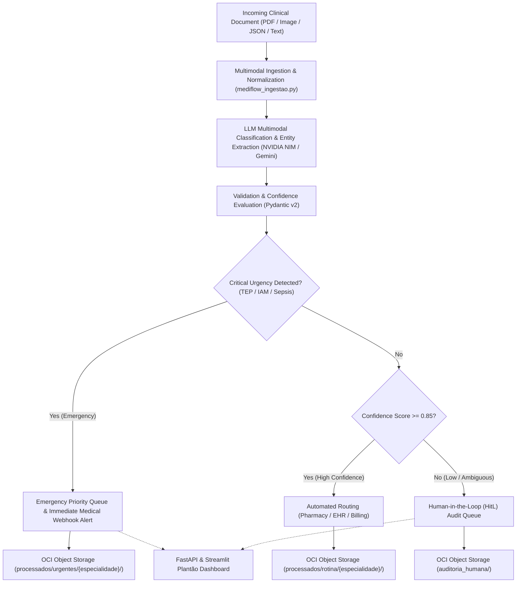

# 🏥 MediFlow — Autonomous Clinical Document Triage, Extraction & Routing Agent

[](LICENSE)
[](https://www.python.org/)
[](https://github.com/No-Country-simulation/G10-BRASIL-equipo-22)
[](ci/ci.yml)
[](tests/)
[](week4/)
[](https://www.oracle.com/cloud/free/)
[](https://langchain-ai.github.io/langgraph/)
[](https://www.oracle.com/br/education/oracle-next-education/)

---

### 🌐 Language / Idioma
- [🇺🇸 English Version (EN-US)](#-english-version-en-us)
- [🇧🇷 Versão em Português (PT-BR)](#-versão-em-português-pt-br)
- [🇪🇸 Versión en Español (ES)](#-versión-en-español-es)

---

## 👥 Squad & Engineering Personas (Equipo 22)

| Persona / Member | Primary Role | Domain & Core Deliverables |
| :--- | :--- | :--- |
| **Carlos Magno** (`@magnomct`) | **Tech Lead & SRE/DevOps** | AI Core Architecture, LangGraph StateGraph, Zero-Downtime SRE Fallback, CI/CD Pipeline, Latency Percentiles (p50..p99) & 50-burst Load Testing. |
| **Fernando Szekut** (`@FSzekut`) | **Agent Integration & Frontend/UX** | Multimodal Document Ingestion (`mediflow_ingestao.py`), Real-Time Webhooks Dispatcher, Streamlit Emergency Alert UI, and Resilient Partial Data Triaging. |
| **Helder Costa Amaral** (`@HelderAmaralConsult`) | **Database & Cloud Storage (OCI)** | OCI Object Storage Always Free dynamic folder segregation (`/processados/{prioridade}/{especialidade}`), SQLite Transactional Audit, and Zero-Cost Quota Guardrails. |
| **Alessandro / Leandro** (`@superjonic`) | **Backend FastAPI & QA** | FastAPI REST API inspection endpoints (`/api/v1/grafo/estrutura`, `/api/v1/telemetria`), automated Pytest test suites, and Agile Kanban governance. |

---

## 🇺🇸 English Version (EN-US)

### 1. Overview & Business Problem
Hospitals, clinical laboratories, and health insurance providers process thousands of heterogeneous documents every day:
- Medical Prescriptions (*Receituários*)
- Imaging & Laboratory Diagnostic Reports (*Laudos*)
- Authorization Guides (*Guias TISS/TUSS*)
- Surgical & Inpatient Discharge Summaries
- Sick Leave Certificates (*Atestados*)

Manual processing causes severe operational bottlenecks, transcription errors, glosas (insurance payment denials), and life-threatening delays in treating urgent conditions (e.g., Acute Pulmonary Embolism, Stroke, Sepsis).

**MediFlow** is an autonomous AI agent engineered to ingest, classify, extract structured clinical data, evaluate confidence scores, and conditionally route clinical documents to target hospital queues or Human-in-the-Loop auditors, persisting all assets in **Oracle Cloud Infrastructure (OCI) Object Storage (Always Free tier)**.

---

### 2. Consolidated System Capabilities (Release 1.5 — Sprint M5)

1. **Multimodal Ingestion Engine (`mediflow_ingestao.py`)**: Supports raw text, JSON, digital/scanned PDFs (`pypdf`), and medical images (`Pillow`), connected natively to the LangGraph `ingestor_node`.
2. **Formal LangGraph StateGraph (`week3/agent.py`)**: Typed state transitions (`MediFlowAgentState`), classification node, clinical extraction node, validator node, and deterministic conditional routing edges.
3. **Clinical Priority & Urgency Scoring**: Detects life-critical findings and computes an extraction confidence score ($0.0 \le \text{score} \le 1.0$).
4. **Emergency Alert & Webhook Dispatcher (`week3/notifications.py`)**: Real-time HTTP alerts dispatched to emergency duty medical teams with latency recording, partial-data resilience, and manual resend capabilities.
5. **Human-in-the-Loop (HitL) Interactive UI (`app.py`, `week3/app.py`)**: Streamlit web application providing audit queues, pulsing emergency banners, and single-click doctor approvals.
6. **OCI Cloud Storage & Transactional Audit (`week3/storage.py`)**: Zero-cost storage in OCI Object Storage segregated dynamically by specialty (`processados/{prioridade}/{especialidade}/`), backed by SQLite audit logs.
7. **Production SRE Telemetry & Concurrency (`week4/telemetry_sre.py`, `week4/load_testing.py`)**: Latency percentiles ($p50, p75, p90, p95, p99$), 99.9% error budget enforcement, and stress bursts up to 50 concurrent requests reaching **90.09 req/s** with 100% SLA compliance ($< 5000\text{ms}$).
8. **Automated CI/CD Pipeline (`ci/ci.yml`)**: GitHub Actions workflow running flake8 syntax checks, 102 automated pytest tests, and executive concurrency benchmarks on every push/PR.
9. **SRE Circuit-Breaker Engine (`mediflow_circuit_breaker.py`)**: Canonical CLOSED / OPEN / HALF_OPEN state machine with configurable failure threshold, cooldown window, and automatic fallback to in-process LangGraph when the backend REST API is degraded — Zero Downtime by design. *(CARD-25 / PR #62 — 10/11/2026)*

---

### 3. Decision Graph Architecture



---

### 4. Repository Structure

```
ONE/
├── .github/workflows/ci.yml           # GitHub Actions automated CI/CD pipeline
├── ci/ci.yml                          # Versioned mirror of CI/CD workflow
├── app.py                             # Interactive Streamlit Web UI (HitL & Plantão Alerts)
├── mediflow_agent.py                  # LangGraph Agent with Zero-Downtime SRE Fallback
├── mediflow_circuit_breaker.py          # SRE Circuit-Breaker (CLOSED/OPEN/HALF_OPEN) + Resilient Client (CARD-25)
├── mediflow_ingestao.py               # Multimodal Ingestion Engine (PDF, Images, Text, JSON)
├── mediflow_schemas.py                # Strict Pydantic v2 clinical data contracts
├── oci_storage.py                     # OCI Object Storage Always Free integration service
├── requirements.txt                   # Production Python dependencies
├── requirements-ingestao.txt          # Dedicated dependencies for image/PDF extraction
├── pytest.ini                         # Pytest test discovery & execution configuration
├── test.md                            # Comprehensive test execution & scenario guide
├── tests/                             # Integration & unit test suites
├── week3/                             # Release 1.3: LangGraph, Webhooks, FastAPI & SQLite Storage
│   ├── agent.py                       # Formal compiled LangGraph StateGraph
│   ├── api.py                         # FastAPI REST API (/api/v1/grafo, /api/v1/telemetria)
│   ├── app.py                         # On-duty medical alert UI component
│   ├── notifications.py               # Real-time Webhook dispatcher with HTTP retry & latency
│   ├── storage.py                     # SQLite transactional audit log & OCI specialty paths
│   ├── test_week3.py                  # 8 Automated unit/integration tests
│   └── run_tests.py                   # Executive CLI runner for Week 3
├── week4/                             # Release 1.4: Production SRE, Concurrency & CI/CD
│   ├── telemetry_sre.py               # SRE Engine: Percentiles (p50..p99), SLA & Error Budget
│   ├── load_testing.py                # Concurrent Load Tester (10, 25, 50 simultaneous bursts)
│   ├── test_week4.py                  # 8 Automated SRE tests (percentiles, SLA, load bursts)
│   ├── run_week4_tests.py             # Executive CLI benchmark runner
│   └── README.md                      # Detailed Week 4 architectural documentation
└── G10-BRASIL-equipo-22-Medflow/Docs/ # Original ONE G10 Challenge specifications
```

---

### 5. Quick Start & Execution Guide

#### Setup Virtual Environment
```bash
# Clone the repository
git clone https://github.com/No-Country-simulation/G10-BRASIL-equipo-22.git
cd G10-BRASIL-equipo-22

# Activate Python 3.12+ virtual environment
python3 -m venv .venv
source .venv/bin/activate

# Install dependencies
pip install -r requirements.txt -r requirements-ingestao.txt
```

#### Run Automated Test Suite (102 Tests)
```bash
# Run all automated tests via pytest
pytest

# Or execute individual sprint test runners with executive banners:
python week3/run_tests.py
python week4/run_week4_tests.py
```

#### Run Web Interfaces & APIs
```bash
# Launch Streamlit Clinical Audit & Plantão Dashboard:
streamlit run app.py

# Launch FastAPI REST Service with Swagger UI (http://localhost:8000/docs):
uvicorn week3.api:app --reload --host 0.0.0.0 --port 8000
```

---

<br/>

## 🇧🇷 Versão em Português (PT-BR)

### 1. Visão Geral e Contexto Clínico
Hospitais, clínicas, laboratórios e operadoras de saúde lidam diariamente com volumes massivos de documentos heterogêneos:
- Receituários Médicos
- Laudos de Exames Laboratoriais e de Imagem
- Guias de Solicitação de Procedimentos (Padrão TISS/TUSS)
- Relatórios Cirúrgicos e de Alta/Internação
- Atestados Médicos

A triagem manual destes documentos gera lentidão, alto índice de glosas hospitalares, erros de transcrição e atrasos fatais no atendimento a quadros graves (como Tromboembolismo Pulmonar, Infarto Agudo do Miocárdio e Sepse).

O **MediFlow** é um agente autônomo e inteligente para ingestão, classificação automatizada, extração estruturada de entidades clínicas, avaliação de score de confiança e roteamento condicional com suporte a **Human-in-the-Loop**, com persistência no **Oracle Cloud Infrastructure (OCI) Object Storage (Camada Always Free)**.

---

### 2. Capacidades do Sistema Consolidado (Release 1.5 — Sprint M5)

1. **Pipeline de Ingestão Multimodal (`mediflow_ingestao.py`)**: Recebe arquivos em texto puro, JSON estruturado, PDFs digitais e escaneados (`pypdf`), além de imagens médicas (`Pillow`), integrados diretamente ao `ingestor_node` do LangGraph.
2. **Grafo de Estados Formal LangGraph (`week3/agent.py`)**: Orquestração com tipagem estrita (`MediFlowAgentState`), nós desacoplados (ingestão, classificação, extração, validação) e arestas condicionais determinísticas.
3. **Detecção de Urgências e Pontuação de Confiança**: Identifica patologias críticas de risco de vida e calcula score de confiança ($0.0 \le \text{score} \le 1.0$).
4. **Despachador de Alertas e Webhooks (`week3/notifications.py`)**: Disparo de webhooks HTTP em tempo real para equipes de plantão médico com rastreamento de latência, tolerância a dados parciais e reenvio manual.
5. **Interface Human-in-the-Loop Interativa (`app.py`, `week3/app.py`)**: Painel web em Streamlit com filas de auditoria, banners visuais pulsantes de emergência e aprovação médica em 1 clique.
6. **Persistência em Nuvem OCI e Auditoria SQLite (`week3/storage.py`)**: Armazenamento com custo zero no OCI Object Storage particionado dinamicamente por especialidade (`processados/{prioridade}/{especialidade}/`), com espelho auditável transacional em SQLite.
7. **Telemetria de Produção SRE e Testes de Carga (`week4/telemetry_sre.py`, `week4/load_testing.py`)**: Cálculo de percentis lineares ($p50, p75, p90, p95, p99$), garantia de SLA (< 5s), controle de Error Budget (99.9%) e testes com até 50 requisições simultâneas atingindo **90 req/s** com 100% de sucesso.
8. **Pipeline CI/CD Automatizado (`ci/ci.yml`)**: GitHub Actions com validação sintática flake8, execução dos 102 testes pytest e verificação de concorrência a cada push ou pull request.
9. **Motor de Circuit-Breaker SRE (`mediflow_circuit_breaker.py`)**: Máquina de estados canônica CLOSED / OPEN / HALF_OPEN com limiar de falhas configurável, janela de arrefecimento e chaveamento automático para o motor LangGraph in-process quando a API backend estiver degradada — Zero Downtime por design. *(CARD-25 / PR #62 — 10/11/2026)*

---

### 3. Cenários de Avaliação Homologados

- **Cenário 1 (Fluxo de Rotina Aprovado)**: Receita ambulatorial com dados legíveis e alta confiança ($\ge 0.85$) $\rightarrow$ roteada para Farmácia e Prontuário sem intervenção humana.
- **Cenário 2 (Prioridade de Urgência Médica)**: Laudo com achado grave (ex: Tromboembolismo Pulmonar Agudo / TEP) $\rightarrow$ prioridade Urgente, disparo imediato de Webhook ao plantão e gravação segregada no bucket OCI.
- **Cenário 3 (Ambiguidade / Baixa Confiança)**: Documento ilegível ou com dados contraditórios $\rightarrow$ roteamento para fila de auditoria humana (*Human-in-the-Loop*).

---

<br/>

## 🇪🇸 Versión en Español (ES)

### 1. Visión General y Contexto Clínico
Hospitales, clínicas, laboratorios y aseguradoras de salud gestionan a diario un volumen masivo de documentos heterogéneos:
- Recetas Médicas (*Prescripciones*)
- Informes y Resultados de Exámenes Diagnósticos e Imagenológicos (*Laudos*)
- Volantes y Guías de Autorización de Procedimientos (Estándar TISS/TUSS)
- Resúmenes de Alta e Informes Quirúrgicos
- Certificados de Incapacidad / Bajas Médicas

El procesamiento manual de estos documentos genera cuellos de botella operativos, altos índices de glosas (rechazos de facturación médica), errores de transcripción y demoras potencialmente fatales en la atención de patologías críticas (como Tromboembolismo Pulmonar Agudo, Infarto Agudo de Miocardio y Sepsis).

**MediFlow** es un agente autónomo e inteligente diseñado para la ingesta, clasificación automatizada, extracción estructurada de entidades clínicas, cálculo de score de confianza y enrutamiento condicional con soporte de **Human-in-the-Loop** (auditoría humana), con persistencia de documentos y decisiones en **Oracle Cloud Infrastructure (OCI) Object Storage (Capa Always Free)**.

---

### 2. Capacidades del Sistema Consolidado (Release 1.5 — Sprint M5)

1. **Motor de Ingesta Multimodal (`mediflow_ingestao.py`)**: Soporta texto plano, JSON, PDF (digital y escaneado) e imágenes médicas conectado directamente al nodo inicial de LangGraph.
2. **Grafo de Decisión LangGraph StateGraph (`week3/agent.py`)**: Flujo de estados tipado con enrutamiento condicional y tolerancia a fallos.
3. **Detección de Urgencias y Alertas en Tiempo Real (`week3/notifications.py`)**: Despacho de Webhooks para el equipo médico de guardia ante hallazgos críticos (TEP/IAM) con historial de latencia y reenvío manual.
4. **Panel de Control Human-in-the-Loop en Streamlit (`app.py`, `week3/app.py`)**: Interfaz web intuitiva para revisión médica y aprobación con 1 clic.
5. **Almacenamiento en OCI Object Storage Always Free (`week3/storage.py`)**: Segregación dinámica por especialidad sin incurrir en costos de facturación.
6. **Telemetría SRE de Producción y Pruebas de Carga (`week4/telemetry_sre.py`, `week4/load_testing.py`)**: Medición de percentiles de latencia ($p50..p99$), control de Error Budget al 99.9% y pruebas de estrés con hasta 50 solicitudes concurrentes (**90 req/s** y 100% SLA).
7. **Integración Continua CI/CD (`ci/ci.yml`)**: Validación automatizada con 102 pruebas pytest en GitHub Actions.
8. **Motor de Circuit-Breaker SRE (`mediflow_circuit_breaker.py`)**: Máquina de estados canónica CLOSED / OPEN / HALF_OPEN con umbral de fallos configurable, ventana de enfriamiento y conmutación automática al motor LangGraph in-process ante degradación de la API backend — Zero Downtime por diseño. *(CARD-25 / PR #62 — 10/11/2026)*

---

## 📄 License / Licença / Licencia
This project is licensed under the terms of the [MIT License](LICENSE).  
Este projeto é licenciado sob os termos da [Licença MIT](LICENSE).  
Este proyecto está licenciado bajo los términos de la [Licencia MIT](LICENSE).
