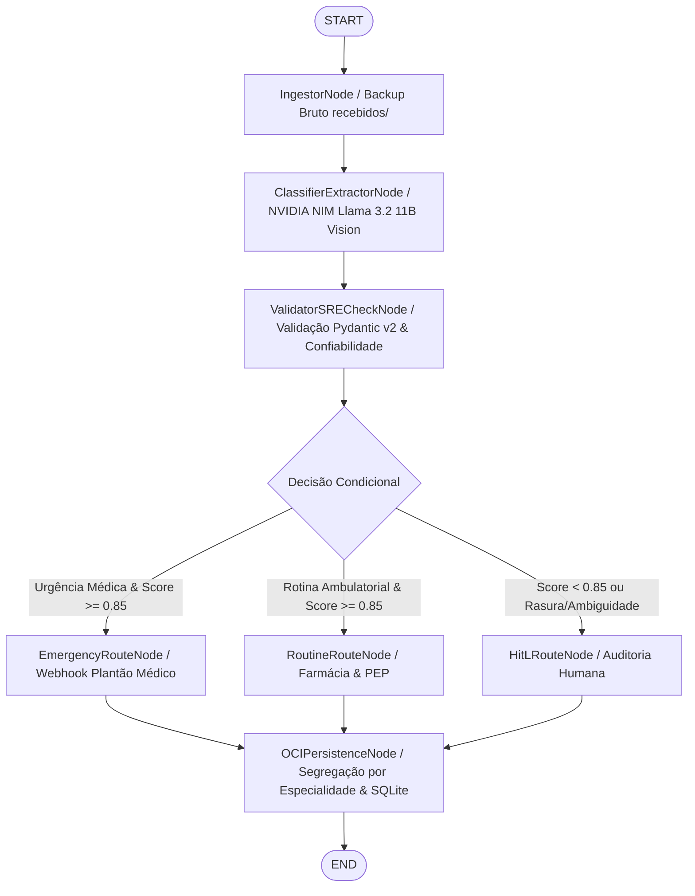

# 🏥 MediFlow — Release 1.3: Grafo de Decisão Condicional (LangGraph), Workflows & OCI Always Free

> **Hackathon ONE G10 — Oracle Next Education & Alura**  
> **Squad / Equipo 22:** Carlos Magno, Fernando Szekut, Helder e Alessandro  
> **Branch de Release:** `release-1.3` (Branch local isolada para homologação do grupo na quinta-feira)  
> **Status:** ✅ 100% Implementado e Testado Localmente (Não sincronizado no GitHub)

---

## 👥 Composição da Squad & Responsabilidades Técnicas

| Integrante / Persona | Papel no Projeto | Entregáveis na Release 1.3 |
| :--- | :--- | :--- |
| **Carlos Magno**<br>([GitHub](https://github.com/magnomct) \| [Portfólio](https://carlosmagnocloudengineer.vercel.app/en))<br>*Persona: Arquiteto Carlos Vance* | **Tech Lead & SRE/DevOps**<br>IA & Python Core | • Orquestração formal com **LangGraph (`StateGraph`)**<br>• Fallback SRE Heurístico Resiliente (Zero Downtime)<br>• Telemetria de latência por nó e enforcement de SLA (< 5.000 ms) |
| **Fernando Szekut**<br>([GitHub](https://github.com/FSzekut) \| [Portfólio](https://fernando-szekut.netlify.app/))<br>*Persona: Fernando Nexus* | **Agent Integration & Workflows**<br>Frontend & UX | • Despachador de notificações em tempo real (`NotificationDispatcher`)<br>• Webhook para emergências (`Alerta_Plantao_Medico`)<br>• Suporte a modo Mock e HTTP real com timeout resiliente |
| **Helder**<br>*Persona: Atlas Data* | **Engenharia de Dados**<br>OCI Always Free & Persistência | • Segregação dinâmica de pastas no OCI por especialidade médica (`processados/urgentes/{especialidade}/...`)<br>• Log transacional de auditoria em SQLite local (`triagem_audit_log`)<br>• Verificador de conformidade Always Free (teto 10 GB gratuito) |
| **Alessandro**<br>*Persona: Marcus Builder* | **Backend Developer**<br>FastAPI & QA | • Endpoints REST v1.3 (`/health`, `/triagem`, `/auditoria`, `/telemetria`)<br>• Endpoint de inspeção do grafo (`/api/v1/grafo/estrutura`)<br>• Módulo de resolução e aprovação Human-in-the-Loop |

---

## 🏗️ Topologia do LangGraph StateGraph

O fluxo de triagem clínica é orquestrado de forma determinística e tipada via `langgraph.graph.StateGraph`:



---

## 📁 Estrutura de Arquivos da Pasta `week3/`

```text
week3/
├── __init__.py           # Exportação dos componentes da Release 1.3
├── agent.py              # MediFlowStateGraphAgent (LangGraph StateGraph, nós e roteador)
├── api.py                # FastAPI v1.3 com endpoints de inspeção e triagem
├── notifications.py      # NotificationDispatcher (Webhooks clínicos e alertas de plantão)
├── storage.py            # OCIStorageServiceV3 (Segregação OCI e histórico SQLite)
├── test_week3.py         # Suite completa de 8 auto-testes com pytest
├── run_tests.py          # Runner executivo CLI com relatório formatado
└── README.md             # Este guia executivo para a reunião de alinhamento
```

---

## 🧪 Bateria de Auto-Testes Automatizados

A pasta `week3/` inclui **8 testes automatizados** cobrindo todos os módulos da Release 1.3:

1. **`test_langgraph_scenario_1_routine`**: Triagem de receita ambulatorial $\rightarrow$ `Farmacia_Hospitalar`, score $\ge 0.85$, sem auditoria.
2. **`test_langgraph_scenario_2_urgency_tep`**: Achado crítico de Tromboembolismo Pulmonar Agudo (TEP) $\rightarrow$ `Fila_Emergencia_Medica`, prioridade `Urgente`, disparo de Webhook para plantão médico.
3. **`test_langgraph_scenario_3_ambiguous_hitl`**: Caso com dosagem ilegível e CRM ausente $\rightarrow$ `Fila_Revisao_Humana`, retenção preventiva preventiva, score $< 0.85$.
4. **`test_webhook_dispatcher_mock`**: Validação de payload do webhook, canais e persistência no histórico de alertas.
5. **`test_oci_dynamic_specialty_paths`**: Resolução dinâmica de slugs por especialidade (`processados/urgentes/radiologia/...`, `processados/rotina/clinica_medica_ambulatorial/...`).
6. **`test_sqlite_transactional_audit_log`**: Inserção, consulta e atualização de status após intervenção de auditor humano.
7. **`test_sre_sla_and_telemetry`**: Medição de latência por nó do grafo e garantia de SLA $< 5.000\text{ ms}$.
8. **`test_fastapi_endpoints_v3`**: Verificação dos endpoints REST (`/health`, `/triagem`, `/auditoria/{id}/aprovar`, `/telemetria`, `/compliance/oci`).

### Como Executar os Testes

#### Opção A — Execução com Pytest:
```bash
pytest week3/test_week3.py -v
```

#### Opção B — Execução com Runner Executivo Formatado (Recomendado para a reunião):
```bash
python week3/run_tests.py
```

---

## 🚀 Como Iniciar a API REST (Release 1.3)

Para rodar o servidor FastAPI da Release 1.3:

```bash
uvicorn week3.api:app --reload --port 8000
```

Documentação interativa disponível em:
- **Swagger UI:** `http://127.0.0.1:8000/docs`
- **ReDoc:** `http://127.0.0.1:8000/redoc`
- **Inspeção do Grafo:** `http://127.0.0.1:8000/api/v1/grafo/estrutura`

---

## 🔒 Política de Controle de Versão e Git

- Os novos arquivos estão isolados no diretório local `week3/` e na branch `release-1.3`.
- **Nenhum arquivo da Semana 3 foi enviado para o repositório remoto GitHub.**
- O Tech Lead Carlos Magno fará a homologação e merge junto aos integrantes na reunião de quinta-feira.

